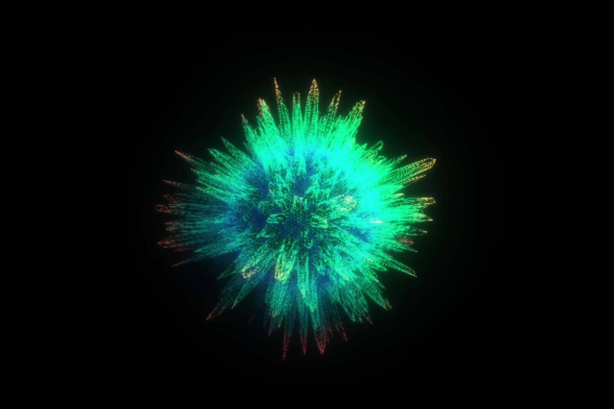

# Hexa Vision

A spiky, slowly morphing sphere seen through the eye of an insect. It runs in the browser with WebGL and three.js, on desktop, tablets and phones.

**[Open it here](https://qc20.github.io/Hexa-Vision/)**



The sphere's surface is pushed around by animated Voronoi noise. Then the whole frame is cut into a honeycomb of tiny lenses, roughly the way an insect's compound eye splits up what it sees. Bloom is applied before the honeycomb, so the glow stays inside each cell instead of smearing across the grid.

## Playing with it

Drag to spin it. A quick flick keeps it gliding for a while. Pinch or scroll to zoom. Tap the surface and a ripple runs across the sphere from that spot; double-tap for a new random look. While your finger is down, the cells underneath swell up like they're under a magnifying glass.

The hexagon button in the bottom-right corner opens the controls: palettes, sliders for the eye and the surface, and a few switches. Close the panel and the button fades out after a few seconds, so nothing sits on top of the picture. Touch the screen and it comes back.

Drift picks a new shape and palette every 12 seconds and melts into it slowly, which is nice if you just want to leave it running. Moving a slider turns it off again. Save exports the current frame as a PNG (on an iPad it opens the share sheet, so it can go straight into Photos). On phones and tablets you can also let the sphere lean as you tilt the device, and there's a switch that listens through the microphone: loudness swells the spikes and bass hits send out ripples.

With a keyboard: <kbd>Space</kbd> shuffles, <kbd>D</kbd> toggles drift, <kbd>S</kbd> saves, <kbd>F</kbd> goes fullscreen, <kbd>C</kbd> opens the controls and <kbd>H</kbd> hides everything.

On an iPad, adding it to the home screen from Safari's share menu gets rid of the browser bars. It opens fullscreen from there.

## How it works

### The surface

The sphere is an icosahedron subdivided 30 times, about 58,000 vertices, drawn as a wireframe. The vertex shader moves every vertex out along its normal by an amount read from a Voronoi pattern.

The pattern is F2 minus F1 Voronoi: for each point, the distance to the second-nearest seed minus the distance to the nearest one. That value is near zero along cell borders and grows toward the middle of a cell, and that's where the ridged, scaly outlines come from. Before any distances are measured, each seed gets nudged by value noise, so the borders wander instead of lining up in a neat grid. The Chaos slider sets how far they wander.

Animating it without popping takes a small trick. Whole numbers of time are treated as keyframes: the shader computes the pattern at `floor(t)` and at `floor(t) + 1` and blends the two with `fract(t)`. The end of one blend is exactly the start of the next, so the pattern never jumps. The Flow slider controls how fast `t` moves.

Wrapping a flat pattern around a sphere with ordinary UVs leaves seams and pinched poles. So the shader samples the pattern three times, once each on the XY, XZ and YZ planes, and blends them using the surface normal as weights. A face pointing along X mostly gets the YZ sample. The weights always add up to 1, which keeps the hand-over between projections invisible.

Ripples live in four slots, each holding a direction on the sphere and a start time. For every vertex the shader works out the angle to each ripple's origin and lifts the surface where that angle matches a ring expanding at 1.4 radians per second. The ring closes up again on the far side of the sphere a bit over two seconds later.

### The eye

The HexaVision pass runs last, on the finished frame. It lays two rectangular grids over the screen, offset from each other by half a cell, and each pixel takes whichever cell centre is closer. That gives a proper honeycomb with straight edges. The distance to the cell edge comes straight from the hexagon's symmetry, with no texture lookups, and it drives the gap between cells, a darker rim and a faint red and blue fringe near the edge of each lens.

With Facets at 0, each cell shows one colour sampled at its centre. Turning it up makes every cell show its own small wide-angle view of the area around it, which is closer to what an insect actually gets.

The magnifier under your finger is a radial warp of the screen coordinates, applied before the honeycomb is built. Both the cells and the image inside them grow near the touch point.

### Keeping it smooth

Controls never jump straight to a new value. Each one eases toward it, which is why shuffles and palette changes blend into each other. The pixel ratio is capped at 2, and the renderer keeps an eye on the frame rate: if it stays under 40 fps, the resolution drops a step at a time. The honeycomb hides most of the difference.

If the scene can't start at all (no WebGL, or the CDN is unreachable), the page says so instead of sitting there blank.

## Running it locally

There's no build step and nothing to install. three.js r128 is loaded from jsDelivr through the import map in `index.html`. Browsers refuse to load ES modules from `file://`, so serve the folder with any static server:

```bash
git clone https://github.com/QC20/Hexa-Vision.git
cd Hexa-Vision
python3 -m http.server 8080
```

Then open http://localhost:8080.

## Project layout

```
index.html           page, import map and the control panel markup
site.webmanifest     home screen / fullscreen app settings
src/js/main.js       scene, gestures, easing and the render loop
src/js/shaders.js    surface shaders and the HexaVision pass
src/js/ui.js         panel, intro, hints and keyboard shortcuts
src/js/palettes.js   palettes and the random palette generator
src/js/sensors.js    tilt and microphone input
src/js/scramble.js   the text scramble in the intro
src/css/style.css
assets/              preview image and app icons
```

To try a different noise on the surface, swap out the `triplanar()` call in the vertex shader. A hexagonal noise there would line up with the honeycomb on screen, and I'd like to see what that does.

## License

MIT, see [LICENSE](LICENSE).
